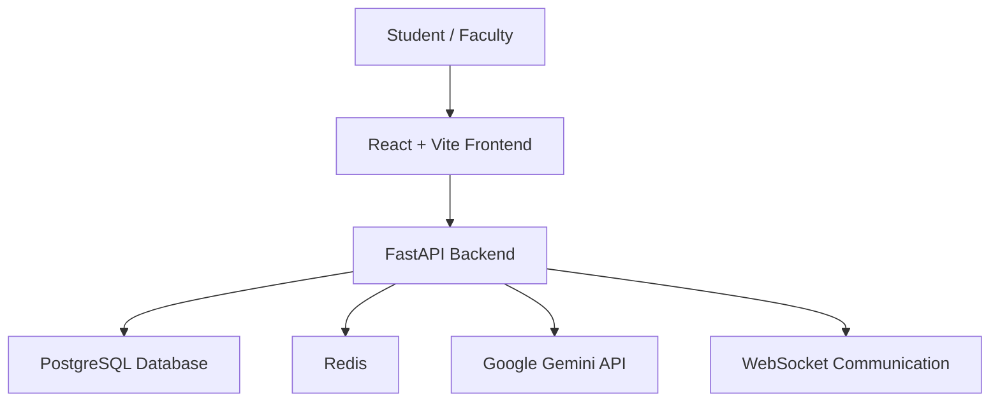

# 🎓 CampusSphere AI

### AI-Powered College Management & Student Support Platform

CampusSphere AI is a smart college support platform designed to connect students and faculty members through academic services, campus communication, and AI-powered assistance.

It provides a centralized digital campus experience where students can access academic resources, communicate with others, explore campus announcements, and get assistance through an AI-powered campus assistant.

[🌐 Live Demo](https://campussphere-ai.pages.dev) · [⚙️ Backend API](https://campussphere-ai-zx3z.onrender.com) · [📖 API Documentation](https://campussphere-ai-zx3z.onrender.com/docs)

---

## ✨ Key Features

### 👨‍🎓 Student Dashboard
- Personalized student dashboard
- Student profile management
- College information and account details
- Quick access to campus services
- Learning resources
- Campus notices and announcements
- Student community
- Academic Q&A
- Messaging functionality
- AI Campus Assistant

### 👩‍🏫 Faculty Dashboard
- Dedicated faculty workspace
- Faculty profile and dashboard
- Student-related information
- Campus communication tools
- Academic support features

### 🤖 AI Campus Assistant
- AI-powered campus assistance
- Interactive student support
- AI integration for campus-related queries

### 💬 Communication & Collaboration
- Student community
- Messaging system
- Academic discussions
- Notices and announcements

---

## 🛠️ Technology Stack

| Category | Technologies |
|---|---|
| Frontend | React.js, Vite, JavaScript |
| Backend | Python, FastAPI |
| Database | PostgreSQL |
| Vector Database | pgvector |
| AI Integration | Google Gemini API |
| Real-time & Messaging | WebSocket |
| Caching / Data Store | Redis |
| Deployment | Cloudflare Pages, Render |
| Version Control | Git, GitHub |

---

## 🏗️ System Architecture



---

## 📂 Project Structure

```text
CampusSphere-AI/
│
├── backend/
│   ├── app/
│   ├── migrations/
│   ├── Dockerfile
│   ├── requirements.txt
│   └── alembic.ini
│
├── frontend/
│   ├── public/
│   ├── src/
│   ├── package.json
│   └── vite.config.js
│
├── docker-compose.yml
├── .env.example
├── .gitignore
└── README.md
```

---

## 🚀 Getting Started

### Prerequisites

Make sure you have installed:

- Python
- Node.js and npm
- PostgreSQL with pgvector
- Redis
- Git

### 1. Clone the Repository

```bash
git clone https://github.com/nishad-uday/CampusSphere-AI.git
cd CampusSphere-AI
```

### 2. Backend Setup

```bash
cd backend

python -m venv env
```

Activate the virtual environment.

**Windows PowerShell:**

```powershell
.\env\Scripts\Activate.ps1
```

Install dependencies:

```bash
pip install -r requirements.txt
```

Configure the backend environment variables using your local `.env` file.

Run database migrations:

```bash
alembic upgrade head
```

Start the backend:

```bash
uvicorn app.main:app --reload
```

Backend API:

```text
http://127.0.0.1:8000
```

API documentation:

```text
http://127.0.0.1:8000/docs
```

### 3. Frontend Setup

Open another terminal:

```bash
cd frontend
npm install
```

Configure the frontend environment variables according to the project's API configuration.

Start the development server:

```bash
npm run dev
```

Frontend:

```text
http://localhost:5173
```

---

## 🌐 Live Deployment

| Service | Platform | URL |
|---|---|---|
| Frontend | Cloudflare Pages | https://campussphere-ai.pages.dev |
| Backend | Render | https://campussphere-ai-zx3z.onrender.com |
| API Documentation | FastAPI / Swagger | https://campussphere-ai-zx3z.onrender.com/docs |

---

## 🔐 Environment Configuration

The application requires environment variables for database connectivity, authentication, Redis, AI integration, and frontend-backend communication.

Configure the required values in your local environment files.

**Important:** Never commit actual API keys, database passwords, or secret keys to GitHub.

---

## 🎯 Project Objective

The main objective of CampusSphere AI is to make college-related services more accessible through a centralized platform.

It aims to improve communication between students and faculty, simplify access to academic information, and provide AI-powered assistance for campus-related queries.

---

## 🔮 Future Enhancements

- Enhanced AI-powered academic assistance
- Improved real-time communication
- Advanced learning resource management
- More academic collaboration features
- Additional campus automation capabilities

---

## 👨‍💻 Developer

**Uday Kumar**

B.Tech – Computer Science & Engineering

Full Stack Developer | AI & Machine Learning Enthusiast

GitHub: [@nishad-uday](https://github.com/nishad-uday)

---

<p align="center">
  <b>CampusSphere AI – Connecting Campus Through Technology 🚀</b>
</p>
